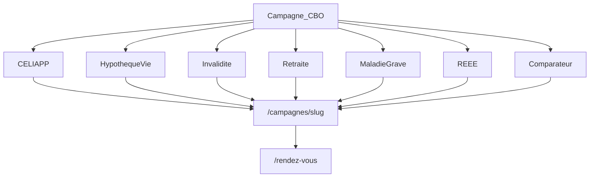

# Campagne Meta Ads — Catalogue multi-sujets (CBO)

**Marque :** Pierre-Olivier Caouette, conseiller en sécurité financière  
**Objectif business :** réserver une rencontre exploratoire (15–30 min)  
**Structure :** 1 campagne CBO + 1 ensemble d’annonces par thème  
**Durée test :** 4–6 semaines, puis scale des ensembles gagnants  
**Conformité :** valider textes + visuels par conformité iA / superviseur **avant** diffusion payante.

Liens de base :
- Rendez-vous : https://www.pierreoliviercaouette.ca/rendez-vous  
- Comparateur : https://www.pierreoliviercaouette.ca/outils/comparateur-rendements  
- Landings campagne : https://www.pierreoliviercaouette.ca/campagnes/{slug}

Créatifs détaillés : `emails/campagne-meta-catalog/`  
Visuels mythe bancaire (réemploi) :
- `emails/campagne-mythe-bancaire/facebook-campagne-rendements.png`
- `emails/campagne-mythe-bancaire/facebook-campagne-rendements-9x16.png`

---

## 1) Logique

Donner à Meta **plusieurs intentions claires** (CELIAPP, hypo+vie, invalidité, etc.) dans une seule campagne à budget partagé. L’algo alloue vers les thèmes qui convertissent ; chaque ensemble garde des créatifs cohérents avec l’intention.



Conversion primaire : **clic vers landing → réservation** sur `/rendez-vous`.  
Sur chaque landing `/campagnes/:slug` : **outil interactif** simple (simulateur, checklist, estimateur) avant les puces / FAQ.  
Conversion secondaire : lecture module `/apprendre/...` (éducation, pas l’objectif Ads).

---

## 2) Setup Ads Manager (copier-coller)

### Campagne
- Nom : `2026 | CBO Catalog | Particuliers RDV`
- Objectif phase 1 : **Trafic** (lien)
- Achat d’annonces : Enchères
- **Advantage campaign budget (CBO) : activé**
- Budget journalier test : **120–200 $ / jour** (14 ensembles — laisser assez de volume à l’algo)
- Emplacements : Advantage+
- Optimisation : **Clics vers le lien** (landing)
- Pixel Meta (ID `3777221109164370`) : chargé **après consentement cookies** via `frontend/src/lib/analytics.js`
- **Conversions à optimiser :**
  - `Lead` — formulaire `/contact` envoyé avec succès (navigateur)
  - `Schedule` — RDV Bookings créé → **Power Automate** → Edge Function Meta CAPI  
    Guide : `supabase/functions/outlook-booking-meta-setup.txt`
  - Secours : bouton « Oui, j’ai réservé » → `/rendez-vous/merci` (à retirer une fois Automate stable)
- Intention : `InitiateCheckout` (CTA RDV) ; `ViewContent` (landings) ; `Contact` (tél./courriel)
- Quand volume OK : objectif Ads Manager sur **Lead** et/ou **Schedule** (pas seulement clics)

### Géo (tous les ensembles)
- Centre-du-Québec / Victoriaville + rayons pertinents  
- Élargir QC si CPA acceptable après 14 jours

### Exclusions (tous)
- Liste clients email (si uploadée)
- Employés / listes internes

---

## 3) Les 14 ensembles

Ton créatif : **même esprit que** `emails/campagne-mythe-bancaire/` — récit à la 1ʳᵉ personne, mythe cassé, preuve / contraste, CTA soft (comparateur ou 15 min), disclaimer.

| # | Nom ensemble | Âge | Landing | UTM content préfixe |
|---|--------------|-----|---------|---------------------|
| 1 | `Comparateur \| Mythe bancaire` | 30–60 | `/campagnes/comparateur-rendements` | `comparateur` |
| 2 | `CELIAPP \| 1re propriété` | 20–40 | `/campagnes/celiapp` | `celiapp` |
| 3 | `Hypothèque + assurance vie` | 28–55 | `/campagnes/hypotheque-assurance-vie` | `hypotheque_vie` |
| 4 | `Assurance invalidité` | 25–55 | `/campagnes/assurance-invalidite` | `invalidite` |
| 5 | `Retraite REER CELI` | 35–60 | `/campagnes/retraite-reer-celi` | `retraite` |
| 6 | `Maladie grave` | 30–55 | `/campagnes/maladie-grave` | `maladie_grave` |
| 7 | `REEE` | 25–50 | `/campagnes/reee` | `reee` |
| 8 | `Fonds d’urgence` | 22–50 | `/campagnes/fonds-urgence` | `fonds_urgence` |
| 9 | `CELI \| Droits inutilisés` | 25–55 | `/campagnes/celi-droits` | `celi_droits` |
| 10 | `Trop jeune pour m’assurer` | 22–40 | `/campagnes/trop-jeune-assurance` | `trop_jeune` |
| 11 | `Assurance collective` | 25–55 | `/campagnes/assurance-collective` | `collective` |
| 12 | `Travailleur autonome` | 25–55 | `/campagnes/travailleur-autonome` | `autonome` |
| 13 | `Plan global` | 30–60 | `/campagnes/plan-global` | `plan_global` |
| 14 | `Succession \| Bases` | 35–65 | `/campagnes/succession-bases` | `succession` |

**Ciblage :** audiences **larges** (Advantage+ ou intérêts légers). Ne pas empiler 15 intérêts.  
**Budget test :** **120–200 $ / jour** CBO (plus d’ensembles = laisser l’algo assez de volume).

**URL de destination (exemple CELIAPP ad1) :**
```
https://www.pierreoliviercaouette.ca/campagnes/celiapp?utm_source=meta&utm_medium=paid&utm_campaign=cbo_catalog_2026&utm_content=celiapp_ad1
```

---

## 4) Matrice d’annonces (résumé)

Chaque ensemble : **2–3 annonces** (textes dans `emails/campagne-meta-catalog/`).  
CTA bouton Meta : **En savoir plus** → landing.

| Ensemble | Ad1 | Ad2 | Ad3 |
|----------|-----|-----|-----|
| Comparateur | Mythe « bons rendements banque » | Chiffre composé 20 ans | Soft outil + RDV |
| CELIAPP | « Je verrai plus tard » | Mise de fonds | Admissibilité |
| Hypo+vie | Assurance banque ≠ famille | Scénario conjoint | 3 questions |
| Invalidité | Revenu = vrai actif | Trous de la collective | 90 jours |
| Retraite | REER vs CELI « toujours pareil » | Horizon flou | Question ouverte |
| MG | Confusion vs invalidité | Capital = temps | Vie vs MG |
| REEE | Subventions sur la table | Rythme | Parent « compte ouvert » |
| Fonds d’urgence | Investir avant le filet | 3–6 mois | Ordre des priorités |
| CELI droits | Droits qui dorment | « J’y pense chaque janvier » | Clarifier l’usage |
| Trop jeune | Mythe âge | Hypothèque jeune | Prix vs risque |
| Assurance collective | « Ce que ton assurance collective t’offre » | Si tu changes d’employeur | Ajouter sans payer deux fois |
| Autonome | Pas de coll. | Revenu + hypo | Filet minimal |
| Plan global | Produits isolés | Transitions de vie | Une feuille de route |
| Succession | « On verra plus tard » | Liquidité vs testament | 3 questions |

---

## 5) Règles d’optimisation

| Jour | Action |
|------|--------|
| J1–J5 | Laisser tourner. Répondre commentaires / DM &lt; 2 h |
| J7 | Couper annonces avec CPA (clic landing) **2×** pire que la moyenne de l’ensemble |
| J14 | Si un ensemble mange &gt;50 % du budget avec CPA faible → laisser ; si CPA élevé + volume bas → baisser plafond ou pause |
| J21 | Doubler le budget global si CPA RDV acceptable ; sinon retirer 1–2 ensembles perdants |
| J28–J42 | Scale gagnants ; préparer vague 2 (corpo / patrimoine) |

**KPI ordre de grandeur (test local) :**
- CTR lien &gt; **1,2–1,8 %**
- Coût / clic landing à surveiller par thème
- Objectif business : **RDV bookés / semaine** (suivre manuellement + UTM)

---

## 6) Pixel & tracking (checklist)

- [ ] Pixel Meta installé (PageView site-wide)
- [ ] Événement utile sur `/rendez-vous` (ViewContent ou Lead) et, si possible, **Schedule** après confirmation Outlook
- [ ] Tester l’événement avec Meta Events Manager (outil de test)
- [x] Landings `/campagnes/*` envoient `view_item` (GA/PostHog) avec `item_id = campagne_{slug}` *(implémenté dans `CampagneAdsLanding.jsx`)*
- [x] CTA RDV envoient `select_content` avec `item_id = campagne_{slug}_rdv` *(implémenté)*
- [x] UTM préservés du clic pub → landing → `/rendez-vous` (`buildCampagneRdvPath`)
- [ ] UTM présents sur **chaque** URL d’annonce dans Ads Manager
- [ ] Rapport hebdo : ensemble × dépenses × clics × RDV (table manuelle ou GA4)

**Événement à optimiser en phase 1 :** clics vers le lien (trafic).  
**Phase 2 (volume) :** basculer l’optimisation vers `Schedule` / `Lead` si l’événement est fiable.

**Schéma UTM (obligatoire sur chaque annonce) :**
```
utm_source=meta
utm_medium=paid
utm_campaign=cbo_catalog_2026
utm_content={theme}_ad{n}
```
Ex. CELIAPP annonce 1 → `utm_content=celiapp_ad1`  
Si l’internaute clique le CTA sur la landing sans UTM pub, fallback : `{slug}_landing`.

---

## 7) Conformité (non négociable)

- Titre exact : **conseiller en sécurité financière**
- Pas de promesse de rendement / résultat garanti / « meilleur placement »
- Chiffres (plafonds CELIAPP, subventions REEE, etc.) : revalider avant diffusion
- Comparateur / rendements : disclaimer illustration + date + passés ≠ futurs (voir campagne mythe bancaire)
- Contenu **éducatif et général** — pas un conseil personnalisé
- Validation iA / superviseur avant Ads Manager

---

## 8) Checklist avant « Diffuser »

- [ ] 14 ensembles créés + 2–3 annonces chacun
- [ ] Landings `/campagnes/*` en prod, testées mobile
- [ ] UTM collés sur chaque annonce
- [ ] Visuels feed (+ Stories si dispo) uploadés
- [ ] Commentaires : réponses types prêtes (voir copies)
- [ ] Validation conformité faite
- [ ] Budget journalier CBO + plafond mensuel définis
- [ ] Pixel vérifié

---

## 9) Vague 2 (hors scope immédiat)

- Ensembles corporatif / patrimoine / convention actionnaires  
- Lookalike 1 % des bookés RDV uniquement  
- Creative vidéo face caméra 15–20 s par thème gagnant
